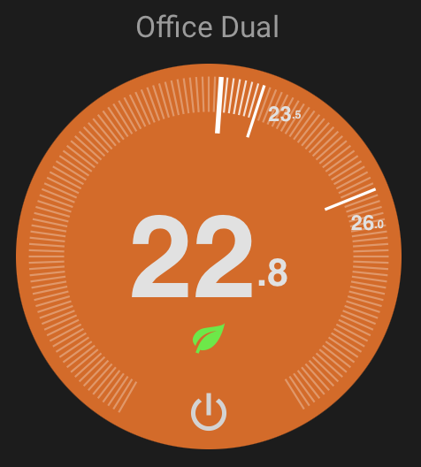
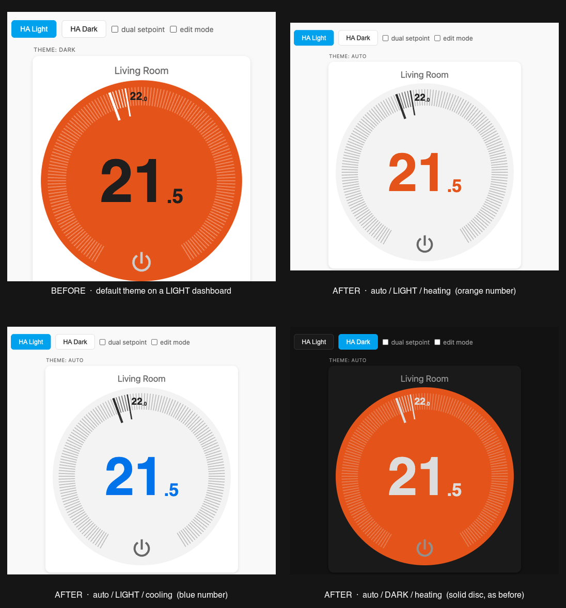

# Thermostat Dark Card

[English](README.md) | 🌐 Supports: English, 中文 (Chinese Simplified), Slovenčina (Slovak)

[](https://hacs.xyz/docs/marketplace/)
[](https://github.com/ciotlosm/lovelace-thermostat-dark-card/releases)
[](https://github.com/ciotlosm/lovelace-thermostat-dark-card/actions)
[](https://github.com/ciotlosm/lovelace-thermostat-dark-card/blob/main/LICENSE)
[](https://github.com/ciotlosm/lovelace-thermostat-dark-card/releases)

A Nest-style thermostat card for Home Assistant with a round dial interface. Supports single and dual (heat/cool) setpoints, preset modes, and multiple skins.

<!-- Add screenshot: place your preview image at docs/preview.png -->


**Key features:**
- Pure SVG rendering — lightweight, no images, optimized for low bandwidth
- Single and dual (heat/cool) temperature modes
- Ring drag interaction for setting temperature
- Chevron controls with finger-sized touch targets on narrow cards
- Predictive state feedback while editing
- Follows the Home Assistant theme — light and dark, with your theme's colors
- Fixed dark, light and transparent skins if you prefer them
- Preset mode indicators (eco, away, home, sleep, boost, comfort, activity)
- Responsive — scales to any card size

## Installation

<!-- ha-marketplace:exclude-start -->

### Marketplace (Home Assistant 2026.11 and newer)

Home Assistant 2026.11 ships HACS as the built-in **Marketplace**, under
**Settings → Marketplace**. There is nothing to install first.

[](https://my.home-assistant.io/redirect/marketplace_repository/?owner=ciotlosm&repository=lovelace-thermostat-dark-card&category=plugin)

Or manually:

1. Open **Settings → Marketplace**
2. Search for "Thermostat Dark Card"
3. Install it, then reload your browser

The Marketplace installs the card as a dashboard resource for you, so there is no
resource to add by hand.

### HACS (Home Assistant 2026.10 and older)

[](https://my.home-assistant.io/redirect/hacs_repository/?owner=ciotlosm&repository=lovelace-thermostat-dark-card&category=plugin)

1. Open HACS in Home Assistant
2. Search for "Thermostat Dark Card"
3. Install and restart Home Assistant

### Manual

1. Download `thermostat-dark-card.js` from the [latest release](https://github.com/ciotlosm/lovelace-thermostat-dark-card/releases)
2. Place it in `config/www/`
3. Add the resource in Settings → Dashboards → Resources:
   - URL: `/local/thermostat-dark-card.js`
   - Type: JavaScript Module

<!-- ha-marketplace:exclude-end -->

> **Upgrading to Home Assistant 2026.11?** The Marketplace takes over from HACS
> automatically. Everything you installed stays installed and keeps updating.
> Dashboard resources move to `/local/community/<repository name>/` — the old
> `/hacsfiles/` paths keep working.

## Usage

```yaml
type: custom:thermostat-dark-card
entity: climate.living_room
```

## Interaction

| Gesture | Result |
|---------|--------|
| Tap the dial | Enter edit mode — the chevrons appear |
| Tap ▲ / ▼ | Raise / lower the target temperature by one step |
| Drag on the tick ring | Set the temperature to the dragged position |
| Tap the tick ring | Nothing — a plain tap never changes the setpoint |
| Long-press / right-click | Open the Home Assistant entity dialog |

The chevrons are the primary control on small screens. Their touch targets grow automatically as
the card gets narrower, so they stay large enough to hit with a finger.

## Temperature display

The dial shows temperatures with the precision of the thermostat's step: whole degrees when the
step is 1 or more (typical for °F), one decimal when it is smaller (typical for °C). Values are
rounded to the nearest degree or tenth, the same way Home Assistant rounds them on its own cards,
so a 68.9 °F setpoint reads 69.

Only the text is rounded. The card keeps working with the exact value the entity reports: the
tick ring, the pointer and every setpoint it sends to Home Assistant use full precision.

## Configuration

### UI Options

These are available in the visual card editor:

| Option | Type | Default | Description |
|--------|------|---------|-------------|
| `entity` | string | **required** | Climate entity ID |
| `name` | string / false | entity name | Card title. `false` hides it (YAML only — the editor offers `hide_name` instead) |
| `hide_name` | boolean | `false` | Hide the card title |
| `skin` | string | `auto` | `auto` (follows the HA theme), `dark`, `light`, `transparent`, or `glassy` |
| `step` | number | from entity | Temperature step override (celsius only). Also sets the [display precision](#temperature-display) |
| `readonly` | boolean | `false` | Disable all interaction (display only) |
| `ambient_temperature` | string | — | External temperature sensor entity ID |
| `status_entity` | string | — | Entity whose state is shown as text above temperature |
| `show_power_toggle` | boolean | `true` | Show power on/off button |
| `show_preset_indicator` | boolean | `true` | Show preset mode icon |
| `pending` | number | `3` | Seconds before committing temperature change |

### Advanced Options (YAML only)

For fine-tuning behavior — not exposed in UI:

| Option | Type | Default | Description |
|--------|------|---------|-------------|
| `idle_zone` | number | `0` | Minimum gap between low/high targets in dual mode |
| `range_min` | number | from entity | Override minimum temperature |
| `range_max` | number | from entity | Override maximum temperature |
| `colors` | object | — | Custom color overrides — `heating`, `cooling`, `idle`, `off`, `text` (see below) |
| `preset_icons` | object | — | Map preset names to icons (see below) |

### Expert Options (use at your own risk)

Internal rendering parameters — changing these may break the dial appearance:

| Option | Type | Default | Description |
|--------|------|---------|-------------|
| `diameter` | number | `400` | SVG viewBox size (all proportions are relative to this) |
| `num_ticks` | number | `150` | Number of tick marks on the ring |
| `tick_degrees` | number | `300` | Arc span of tick marks (degrees) |
| `show_ticks` | boolean | `true` | Show tick marks |

### Skins

A skin is how the card draws itself. It is not the same thing as a Home
Assistant theme — see [Two themes, not one](#two-themes-not-one) below.

| Skin | Behaviour |
|------|-----------|
| `auto` | **Default.** Follows the Home Assistant theme. On a dark dashboard the disc is solid orange when heating, like always; on a light dashboard the disc stays neutral and the state color moves to the center temperature |
| `dark` | Fixed dark skin — the same colors on every dashboard, light or dark |
| `light` | Fixed light skin — the same colors on every dashboard, light or dark |
| `transparent` | No disc background, so the card background shows through. Text and ticks follow the Home Assistant theme |
| `glassy` | Like `transparent`, with a cyan accent for the active arc |

```yaml
type: custom:thermostat-dark-card
entity: climate.living_room
skin: auto
```

`auto` reads the theme Home Assistant is actually using. That includes the theme
you picked in **Profile → Theme** and a theme's own light/dark variants, so the
card repaints as soon as you switch mode — no reload needed.

It keeps the palette the card has always had: orange for heating, blue for
cooling, yellow for drying. Only the neutral parts — the tick ring, the preset
and power icons — are taken from your Home Assistant theme.

Where the state color lands depends on the mode:

- **Dark dashboard** — the disc is filled with the state color and the text
  stays light on top of it. The classic look.
- **Light dashboard** — the disc keeps its neutral surface and the center
  temperature takes the state color instead: orange while heating, blue while
  cooling, back to the theme's text color when idle. A big saturated disc is
  heavy on a light card, and the number is what the eye goes to anyway.

The `dark` and `light` skins ignore the Home Assistant theme on purpose: they
look the same everywhere, which is what you want when a card sits on a shared
wall tablet. Use `light` if you want the solid orange disc on a light dashboard.



#### Two themes, not one

There are two independent things in play, and it is worth keeping them apart:

| | What it controls | Where you set it |
|---|---|---|
| **Home Assistant theme** | The whole dashboard — page background, card surface, text colors | Home Assistant, **Profile → Theme** |
| **Card skin** | How the dial itself is drawn | This card's `skin:` option |

The card skin only ever repaints the dial. It never changes the dashboard around
it, and the Home Assistant theme never overrides a fixed skin. The `auto` skin is
the one that links the two: it reads the Home Assistant theme and repaints
whenever you switch between light and dark.

#### `skin:` and Home Assistant's `theme:` option

Every Home Assistant card accepts a `theme:` option that overrides the theme for
that card. That option belongs to Home Assistant, and this card does not read it
— it only sets the skin. The two can be used together:

```yaml
type: custom:thermostat-dark-card
entity: climate.living_room
skin: auto
theme: Nord        # a Home Assistant theme
```

Home Assistant applies the Nord theme to the card, and with `skin: auto` the
dial picks up Nord's colors and repaints with its light/dark mode.

> **Migrating from 2.x.** The skin used to be called `theme:`. It is now called
> `skin:`, so `theme:` is free for Home Assistant to use as its own card-level
> theme option. Rename the option in your YAML:
>
> ```yaml
> # before
> theme: light
> # after
> skin: light
> ```
>
> The card does not read `theme:` at all any more. A leftover `theme: light` is
> treated by Home Assistant as a theme named "light", which does not exist, and
> the card falls back to the default `auto` skin.

Transparent skin example with a room photo:

```yaml
type: custom:thermostat-dark-card
entity: climate.bedroom
skin: transparent
colors:
  text: "#ffffff"
card_mod:
  style: |
    ha-card {
      background: url("/local/bedroom.jpg") center/cover no-repeat;
    }
```

With a custom background, pin the text color with `colors.text` — the default
follows the Home Assistant theme, which may not contrast with your photo.

### Color Overrides

Override disc colors via YAML (not available in visual editor):

```yaml
type: custom:thermostat-dark-card
entity: climate.living_room
colors:
  heating: "#ff5500"
  cooling: "#0088ff"
  idle: "#1a1a1a"
  off: "#444444"
  text: "#ffffff"
```

### Preset Icons

Map custom preset mode names to built-in icons:

```yaml
type: custom:thermostat-dark-card
entity: climate.ecobee
preset_icons:
  vacation: eco
  night: sleep
  party: boost
```

Available icon names: `eco`, `away`, `home`, `sleep`, `boost`, `comfort`, `activity`

Built-in mappings (no config needed):
- `eco`, `away` → leaf
- `home` → house
- `sleep` → moon
- `boost` → flame
- `comfort` → sun
- `activity` → person

Unknown presets show no icon unless mapped via `preset_icons`.

### External Temperature Sensor

Use a separate sensor for the ambient temperature display instead of the climate entity's built-in sensor:

```yaml
type: custom:thermostat-dark-card
entity: climate.living_room
ambient_temperature: sensor.living_room_external_temp
```

The sensor wins whenever it holds a real number. When it is `unavailable`, `unknown` or missing,
the card falls back to the climate entity's own reading.

### When No Temperature Is Reported

Not every thermostat reports a current temperature. A device that is offline, a relay that never
publishes a sensor reading, or a climate entity that is unavailable all leave the card without a
number to show.

The card does not guess and does not freeze on a stale value. Instead:

- The center of the dial carries a **warning sign** instead of the temperature
- The target temperature, the power button and the rest of the card keep working
- The pointer and the active arc are left out — there is no position on the scale to draw them at

The sign is a plain SVG shape, so it needs no icon font and follows the skin's warning color.

## Features

- **Single and dual mode** — Automatically adapts based on entity attributes
- **Missing-temperature warning** — Shows a warning sign instead of a temperature when the
  thermostat does not report one, rather than an empty or broken card
- **Chevron controls** — Tap the up/down arrows to adjust the target temperature. The touch
  targets grow on narrow cards so they stay easy to hit with a finger
- **Ring drag** — Drag on the tick ring to set the temperature. A plain tap on the ring does
  nothing, so a stray finger can never move the setpoint
- **Predictive feedback** — Disc color fades to show predicted heating/cooling state while editing
- **Preset indicators** — Shows a leaf for eco and away, a house for home, a moon for sleep, a flame for
  boost, a sun for comfort and a person for activity
- **Theme-aware** — The default `auto` skin follows the Home Assistant theme: your colors,
  your light or dark mode, repainted the moment you switch
- **More-info dialog** — Long-press (mobile) or right-click (desktop) opens the HA entity dialog
- **Responsive** — Scales to fit any card size

## Releasing (maintainers)

Releases run through [release-please](https://github.com/googleapis/release-please-action). Merging a
feature PR opens a `chore(main): release X.Y.Z` PR, and merging that one publishes the GitHub release with
the built `thermostat-dark-card.js` attached.

**The release PR needs its workflow run approved before it can be merged** — `release-please` creates its
branch with `GITHUB_TOKEN`, and GitHub holds the workflows that run on such a branch in an
approval-required state. In the GitHub UI this is the **Approve workflows to run** banner on the release
PR — one click.

The complete runbook, including the command line steps, is in
[CONTRIBUTING.md](CONTRIBUTING.md#release-process).

## License

MIT
---

## Support

If you find this card useful, consider buying me a coffee:

<a href="https://www.buymeacoffee.com/gUEVWJc" target="_blank"></a>
